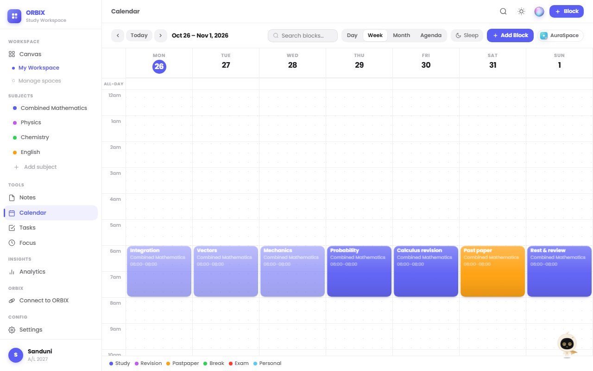
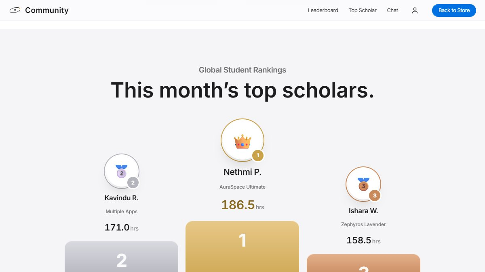
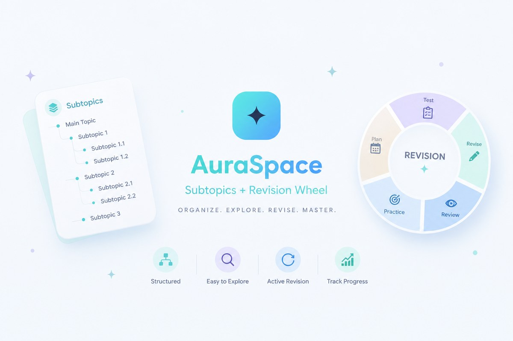
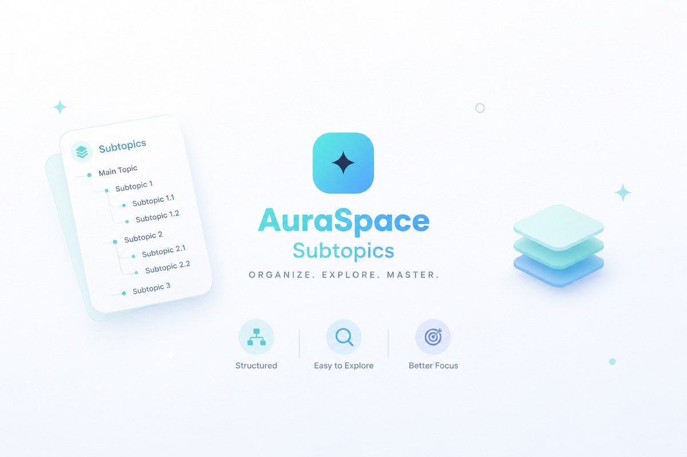
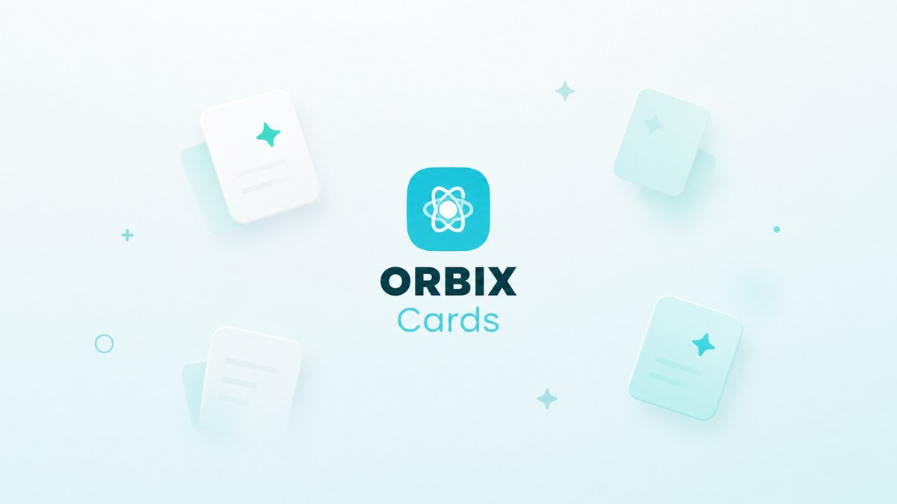
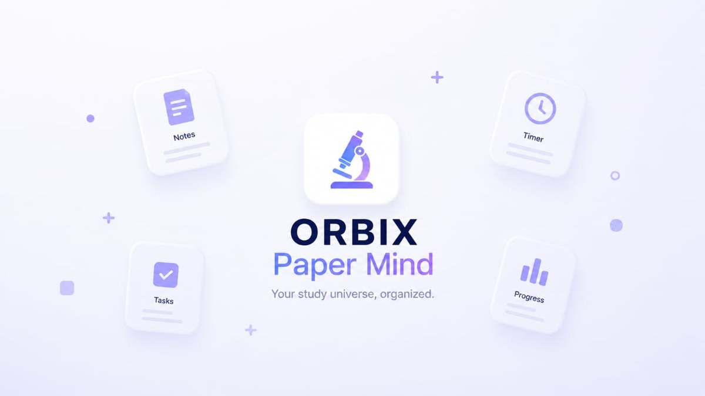
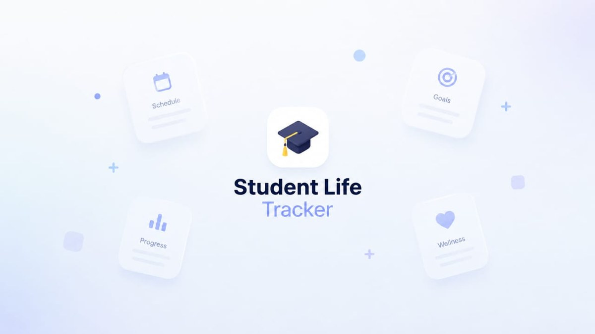
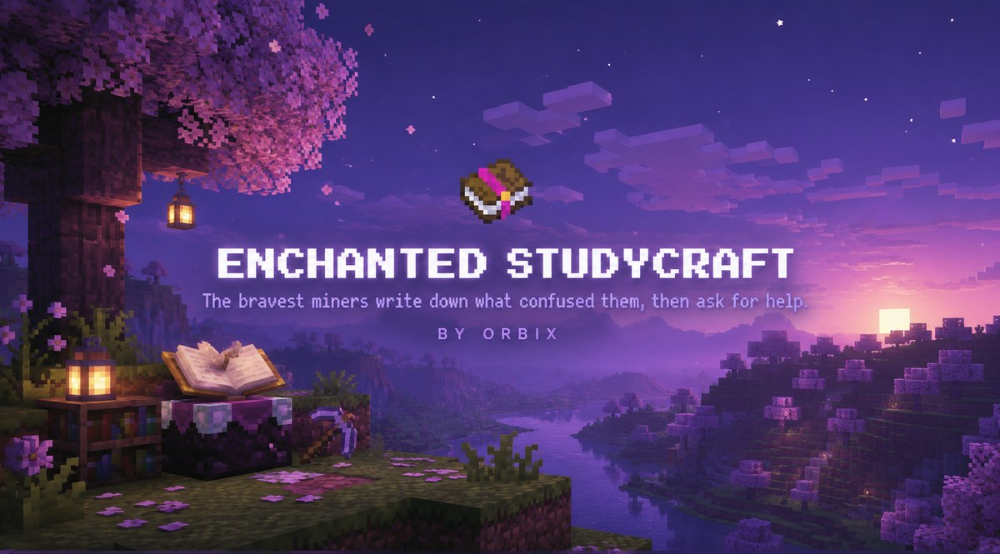
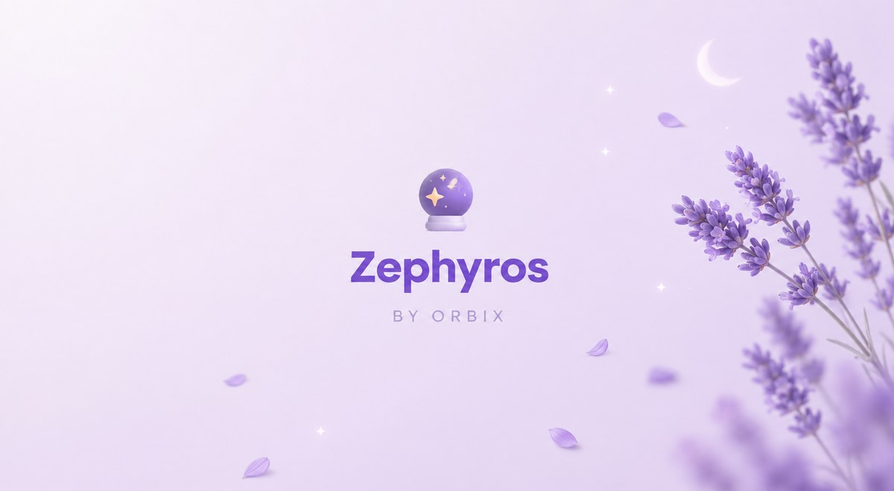
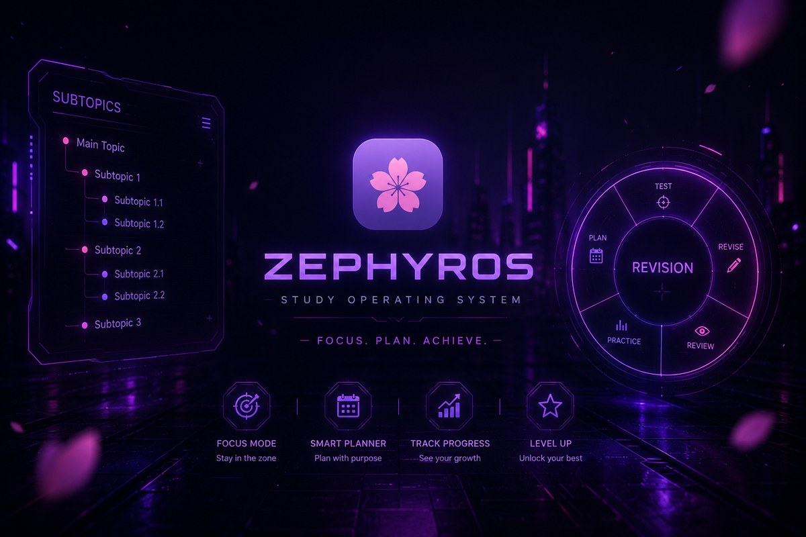

# ORBIX

### A student web app store and study platform, built for Sri Lankan A/L, O/L and university students

**[orbix.lk](https://orbix.lk)** · [Store](https://orbix.lk/store.html) · [Community](https://orbix.lk/community.html)

---

> **This is a showcase repository.** It presents the Orbix project: what it is, what it does and what it looks like.
> It contains **no source code**, internal logic, infrastructure details or business strategy. The product itself is closed-source and all rights are reserved.

---

## What is Orbix?

Orbix is one place for students to find, try and use study tools. Instead of one big app that tries to do everything, Orbix is a **store of focused study apps and study spaces**. Each one is designed around one part of student life: planning, revision, flashcards, past papers, habits, money and choosing a career.

Students can try any app with a **free live demo**, buy the ones they want, and keep everything tied to one **ORBIX account** across their devices. A shared **community** with live leaderboards keeps studying social and motivating.

## Highlights

- 🛍️ **Study app store**: browse, preview and unlock study apps with local (LKR) pricing and instant demos
- 🧠 **OLIA, a study companion**: an animated assistant that lives inside the apps and helps plan revision, add tasks and create flashcards
- 🏆 **Community and leaderboards**: monthly "top scholars" rankings based on real study time
- 👤 **One account**: profile, apps, devices and purchases managed in one place
- 📱 **Installable and fast**: the apps install like native apps on phones and desktops
- 🎨 **Many design styles**: from calm glass and pastel themes to a neon cyberpunk edition

---

## The apps

| App | What it helps with |
| :--- | :--- |
| **AuraSpace Ultimate** | A full study space: nested syllabus planner, calendar time blocks, focus studio, analytics and the Revision Wheel |
| **Enchanted Studycraft** | A themed study space with planning, focus sessions and progress tracking |
| **Zephyros** (Blossom, Lavender, Cyberpunk) | Aesthetic focus dashboards with timers, notes, ambient sound and a distraction blocker |
| **ORBIX Workspace** | A freeform study canvas with notes, calendar, tasks, focus timer and analytics |
| **ORBIX Cards** | Spaced-repetition flashcards for active recall, with review heatmaps and deck sharing |
| **ORBIX PaperMind** | Past paper tracker, mistake notebook and exam score analytics |
| **Student Life Tracker** | Daily habits, sleep, water, mood and study routine |
| **ORBIX Finance** | Student budget, allowance and expense tracking, savings goals and course fees |
| **ORBIX Ikigai** | Self-assessment to explore strengths, A/L streams, degrees and career paths |

### Signature features

- **Revision Wheel**: add topics, spin, and let the wheel pick what to revise next
- **Time-blocking calendar**: plan each day in focused subject blocks with rest periods
- **Focus Studio**: Pomodoro sessions, full-screen focus mode, streaks and ambient soundscapes
- **Analytics**: study hours, subject breakdowns, 14-day momentum and past paper trends
- **XP and achievements**: earn XP for logged study and unlock levels as you progress

---

## Screenshots

<table>
  <tr>
    <td> <b>ORBIX Workspace</b>: weekly calendar with subject blocks</td>
    <td> <b>Community</b>: this month's top scholars</td>
  </tr>
  <tr>
    <td> <b>AuraSpace Ultimate</b></td>
    <td> <b>AuraSpace Advanced</b></td>
  </tr>
  <tr>
    <td> <b>ORBIX Cards</b></td>
    <td> <b>ORBIX PaperMind</b></td>
  </tr>
  <tr>
    <td> <b>ORBIX Finance</b></td>
    <td> <b>ORBIX Ikigai</b></td>
  </tr>
  <tr>
    <td> <b>Student Life Tracker</b></td>
    <td> <b>Enchanted Studycraft</b></td>
  </tr>
  <tr>
    <td> <b>Zephyros Blossom</b></td>
    <td> <b>Zephyros Lavender</b></td>
  </tr>
  <tr>
    <td colspan="2"> <b>Zephyros Cyberpunk</b></td>
  </tr>
</table>

---

## Who it's for

- **A/L and O/L students** preparing for national exams
- **University students** who want structure for coursework and habits
- Anyone who studies better with **clear plans, visible progress and a little friendly competition**

## Try it

Visit **[orbix.lk](https://orbix.lk)**, open the store and launch any app's free demo. No installation needed.

---

## About this repository

This repository exists to showcase the project only.

- ❌ No source code
- ❌ No backend, database or infrastructure details
- ❌ No pricing logic, business strategy or internal documents
- ✅ Product overview, feature list and screenshots

Interested in the project or in working together? Visit **[udulaiw.com](https://udulaiw.com)**.

## License

© 2026 UDULAIW. All rights reserved. See [LICENSE](LICENSE).
The Orbix name, logo, designs and screenshots may not be copied, reused or redistributed without written permission.

Designed and built by <a href="https://udulaiw.com">UDULAIW</a>

